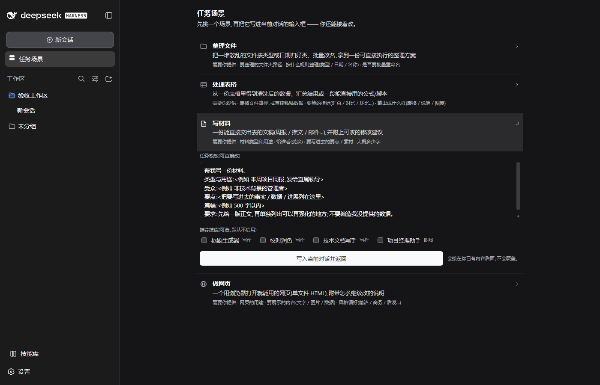

# 与风AI助手

一键装好 AI 助手，并自动接上 DeepSeek。给不写代码的人用的 Windows 桌面安装器。

装完之后，你得到的是一个能直接聊天的 AI 助手界面（本地网页 + 桌面快捷方式），
另带一个 **538 条中文技能的侧栏技能库**——选中就能把技能写进当前对话。

---

## 它做了什么

1. **电脑体检** —— 检查软件自带的运行环境，**不需要你另外装 Node**。
2. **填 DeepSeek API key** —— key 只存在本机，测试和聊天时才发给 DeepSeek 验证。
3. **一键安装** —— 联网下载并安装 AI 助手内核（DeepSeek Harness），装进
   `%LOCALAPPDATA%\ai-setup\agent`，**不污染全局 npm**。
4. **打开助手** —— 在浏览器里直接开始打字聊天，桌面同时生成「与风AI助手」入口。

界面截图（装好后的助手 · 任务场景）：



---

## 下载安装

到 [Releases](../../releases) 下载 `Yufeng-AI-Assistant-Setup-x.y.z.exe` 双击即可。
（本地构建产物名是 `与风AI助手 Setup x.y.z.exe`；GitHub 的资产名不支持中文，会自动转成 ASCII，
安装后的程序与桌面入口仍是「与风AI助手」。）

- 安装位置可自选；会在桌面生成「与风AI助手」快捷方式。
- 升级装同一版本号以上的安装包即可，聊天记录、密钥、技能库都会保留。

## 使用

- **第一次**：填 DeepSeek API key → 点「开始安装」→ 装好点「打开与风AI助手」。
- **日常**：双击桌面的「与风AI助手」；或从安装器点「打开与风AI助手」。
- **技能库**：聊天页左侧栏底部「技能库」→ 搜索/分类 → 勾选 → 「写入当前对话」，
  技能会以 `/技能名` 令牌进到输入框，**不会自动发送**，你看过再按发送。
- **出问题**：安装器上有「一键修复」，会重下组件、重建桌面入口，**保留已有密钥与聊天记录**。

## 官网

产品官网：<https://game.ailover.site/>（备用入口 <http://101.32.194.119/>）

源码在 [`website/`](website/) —— 纯静态 HTML/CSS/JS，**无构建步骤**，丢到任意静态服务器即可。
官网提供安装包直链 `/downloads/Yufeng-AI-Assistant-Setup-0.5.5.exe`（支持 Range 断点续传）与 SHA-256 校验值。

## 开源与反馈

- 项目主页：<https://github.com/chenyangxu442-ai/yufeng-ai-assistant>
- 有问题或建议，欢迎在 [Issues](../../issues) 里反馈交流。

---

## 从源码构建

前置：Node.js ≥ 18、Python（只用来生成 ICO）、Windows。
另需自备随包分发的 Node 运行时放 `app/runtime/node/`（v24.21.0，含 npm）——体积大，不进仓库。

```bash
cd app
npm install                 # Electron + electron-builder

# 首次：把 Codex/设计给的 yufeng.png 转成多尺寸 ICO
python scripts/make-ico.py  # 生成 assets/yufeng.ico(16/24/32/48/64/128/256)

node scripts/dist.js        # 出 release/与风AI助手 Setup <版本>.exe
```

`dist.js` 会：校验自带 Node 运行环境 → 同步 `engine/` → `electron-builder --dir`
→ 用缓存的 `rcedit` 写图标与版本资源 → `--prepackaged` 出 NSIS 安装包。
（内嵌图标不走 electron-builder 自带的 rcedit，原因见 `work/yufeng-branding.md`。）

跑测试：

```bash
cd app && npm test                 # 单元/回归
node ../tests/verify-package.js    # 打包产物:版本、技能数、exe 内嵌图标与版本资源
node ../tests/packaged-asar.mjs    # 打包后的运行时(需要已构建)
node ../tests/installer-branding.mjs  # 真 Chrome 打开装机首页核对品牌/联系方式
node ../tests/panel-runtime.mjs       # 真 Harness + 真 Chrome 核对侧栏技能库与联系入口
```

## 目录结构

```
app/                Electron 外壳(无需任何模型调用即可跑起来看界面)
  main.js           主进程:开窗口、桌面入口、外链白名单
  server.js         本地 Express(localhost)提供 /api/*
  web/index.html    装机向导页面
  assets/           品牌图 yufeng.png / yufeng.ico
  scripts/          make-ico.py(PNG→ICO)、dist.js(打包)
  runtime/node/     随包分发的 Node(npm 亦在此)
engine/             纯 Node 引擎(零依赖):安装、技能、任务、成本、私有环境…
  extensions/skill-library/   注入 Harness 侧栏的技能库与联系入口
tests/              回归测试(含真 Chrome / 真 Harness 的端到端)
```

---

## 上游署名

本应用负责「装好 + 接上 + 加侧栏」；**真正干活的是下列上游项目，版权归各自作者**：

- **DeepSeek Harness**（`@deepseek-ai/dsh`，本版固定 `0.1.5-rc.2`）—— AI 助手内核/聊天界面，
  由 DeepSeek 提供。本仓库只下载并托管它，不改写其许可。
- **Node.js** —— 随包分发的运行时，MIT 类许可（见 `app/runtime/node/LICENSE`）。
- **Electron / Express / yauzl** 等 —— 见各自包内许可。

## 技能库来源与许可

`engine/extensions/skill-library` 的 538 条技能内容**来自上游、不是本项目原创**，按各自条款分发：

| 来源 | 许可 | 条数 |
|---|---|---|
| [f/prompts.chat](https://github.com/f/prompts.chat) | CC0 | 533 |
| [PlexPt/awesome-chatgpt-prompts-zh](https://github.com/PlexPt/awesome-chatgpt-prompts-zh) | MIT | 5 |

catalog 每条记录都带 `source_repo` / `source_url` / `license`；汇总见 `THIRD-PARTY.md`。
**本项目自有代码**用 MIT（见 `LICENSE`），但不代表这些第三方技能也是本项目版权。

## 许可

自有代码：MIT（见 [LICENSE](LICENSE)）。第三方技能与运行时保留各自条款（见上、见 `THIRD-PARTY.md`）。
